# PHYS-TRUST Lite

**Trust-adaptive, physics-informed air-quality estimation on a single low-cost sensor node.**

An Arduino Uno with an MQ135 gas sensor and a DHT11 temperature/humidity sensor streams readings to a Python
estimator that fuses sensor physics, room mass-balance physics and a deep-learning prior (5-LSTM ensemble). Each
source gets a live trust score; the Kalman filter weights sources by trust, a trust state machine decides what the
system should do, and a split-conformal 90 % band states how uncertain the estimate is. A React dashboard shows it
all live, and a local LLM (Gemma 3 4B via Ollama) explains the current state in plain language.

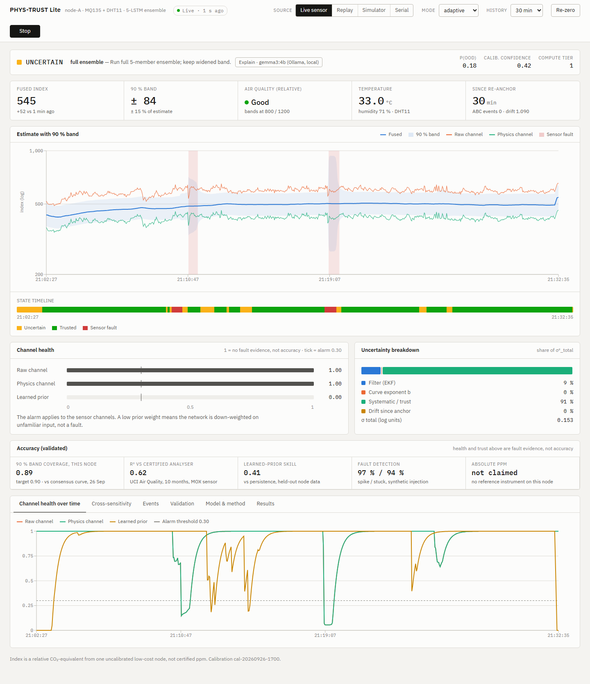

> The output is a **relative CO₂-equivalent index** from one uncalibrated low-cost node, not certified ppm.

---

## Contents
- [Features](#features)
- [Screenshots](#screenshots)
- [How it works](#how-it-works)
- [Results](#results)
- [Hardware](#hardware)
- [Installation and running](#installation-and-running)
- [Project layout](#project-layout)
- [Data sources](#data-sources)
- [Known limits](#known-limits)
- [Contributors](#contributors)

---

## Features

| Area | What it does |
|---|---|
| Sensor physics | ADC → sensor resistance → MQ135 power law `C = a·(Rs / (R0·CF(T,RH)))^b`, datasheet temperature/humidity correction |
| Process physics | Room mass balance `dC/dt = S/V − λ(C − C_bg)`, plausibility envelope, ASTM E741 decay fit |
| Deep learning | 5-member bootstrap LSTM ensemble on a 60-s sequence of [Δlog C, T, RH]; ensemble spread = epistemic uncertainty; admission test disables the prior if it does not beat persistence |
| Trust | Per-channel trust from innovation (NIS), rate plausibility, noise, T/RH envelope, sensor lag and out-of-distribution score |
| Fusion | Extended Kalman filter, state [C, log drift], measurement noise `R = R0 / trust` |
| Uncertainty | `σ² = q²(σ²_EKF + σ²_b + σ²_sys/trust) + k_d·t`, split-conformal 90 % band |
| States and actions | TRUSTED, UNCERTAIN, CALIBRATION_NEEDED, OUT OF DISTRIBUTION, PHYSICS_MISMATCH, SENSOR_FAULT, each with an action; adaptive compute (1 ensemble member when trusted) |
| Out-of-distribution | Feature distance (Gaussian mixture), ensemble disagreement, T/RH envelope and signal novelty, combined into P(OOD) with a named cause |
| Calibration | Clean-air R0 anchor, manual re-zero, automatic baseline calibration (ABC), consensus curve coefficients |
| Validation | UCI Air Quality (certified analyser), Open-Meteo weather for Chennai, synthetic fault injection |
| Dashboard | React + FastAPI + WebSocket: live sensor, replay, simulator and direct serial; auto-reconnect; event markers |
| Explanations | Local Gemma 3 4B (Ollama) explains the detected state; commentary only, never changes the estimate |

---

## Screenshots

**Live sensor.** State, action, fused index with 90 % band, channel health, uncertainty breakdown and validated accuracy.


**Simulator.** A synthetic 2-hour day with injected faults. A swab spike is flagged as SENSOR_FAULT while the
fused estimate holds.

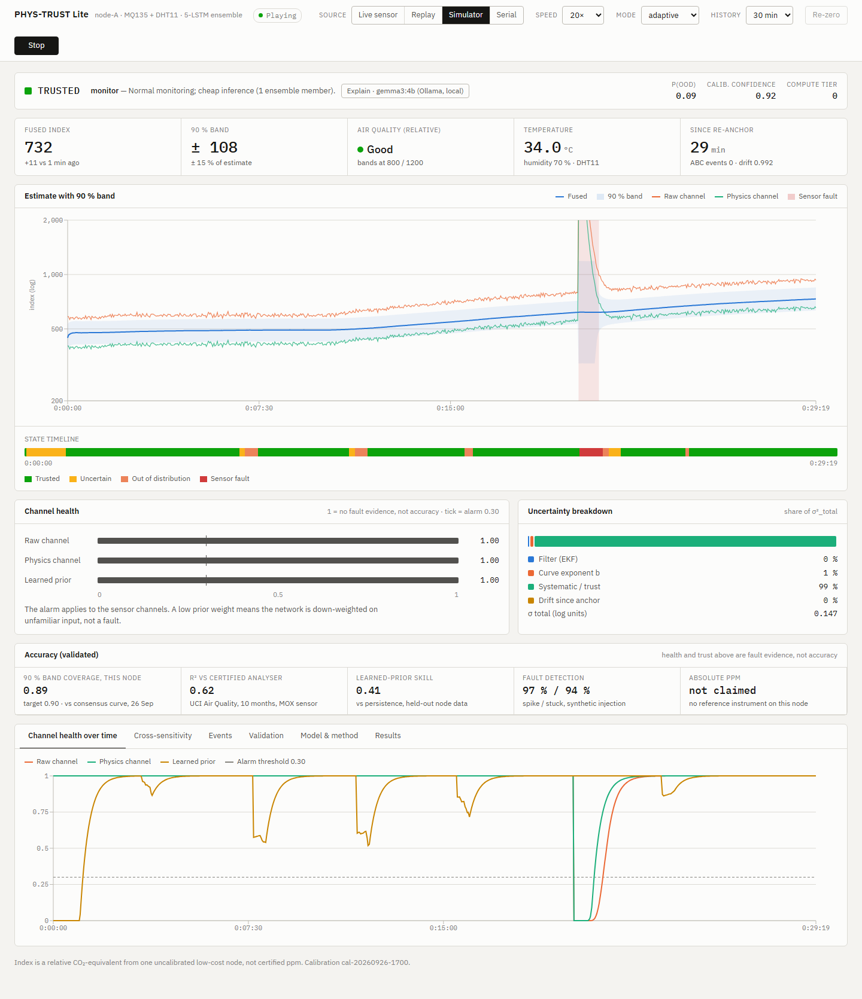

| Channel health over time | Cross-sensitivity (T/RH) |
|---|---|
| 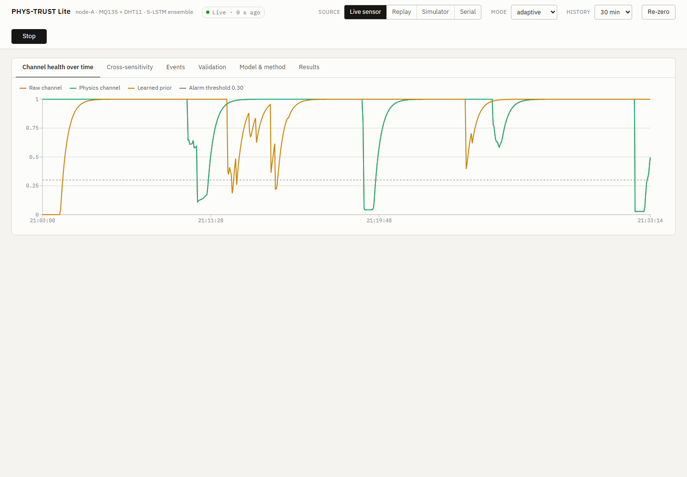 | 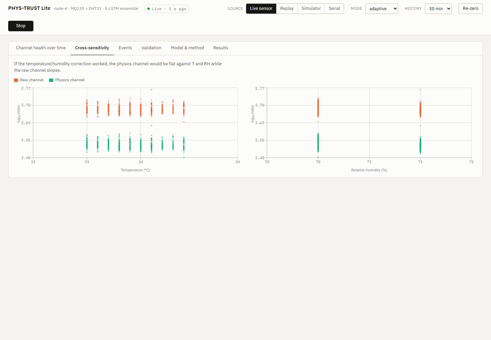 |

| Events and markers | Validation |
|---|---|
| 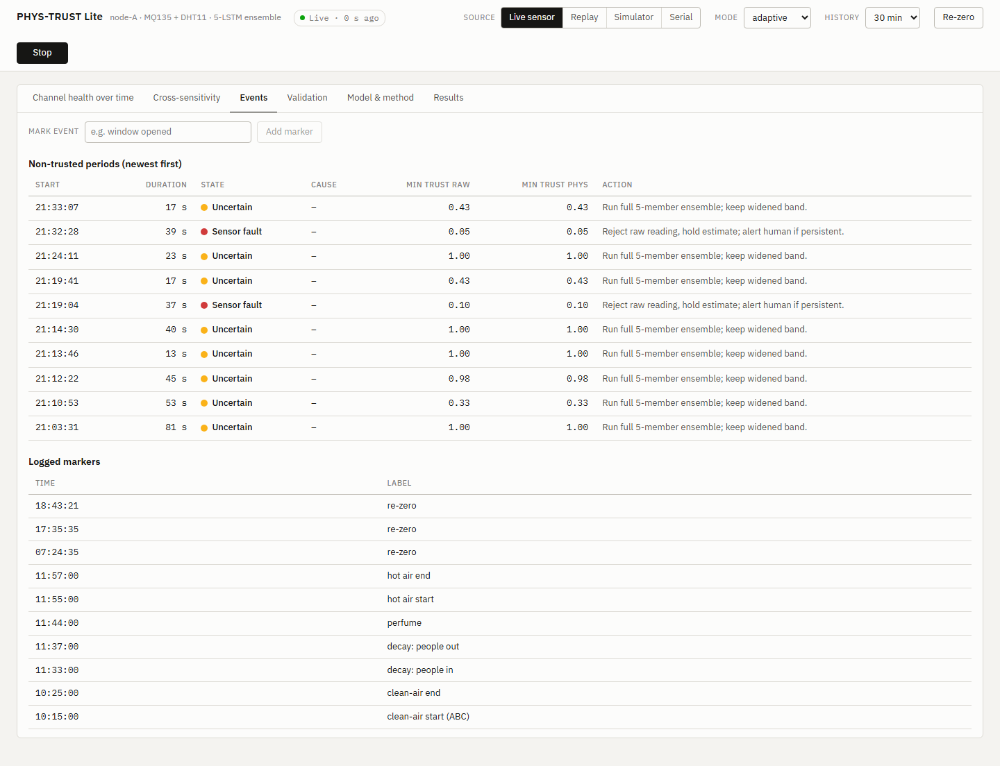 | 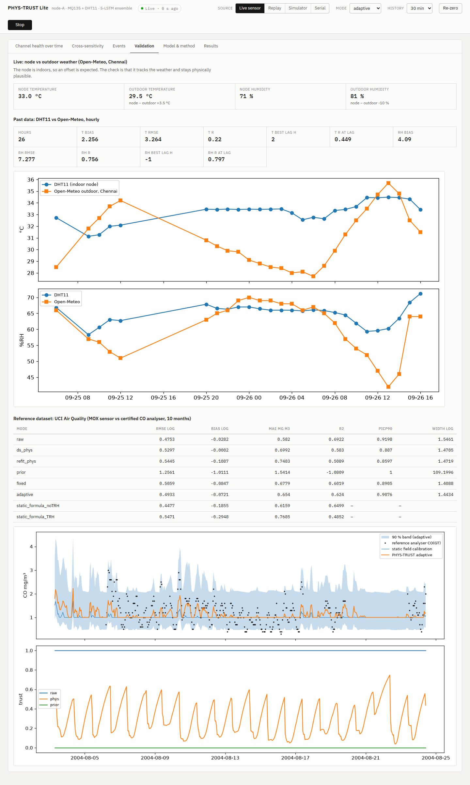 |

| Model and method | Results |
|---|---|
| 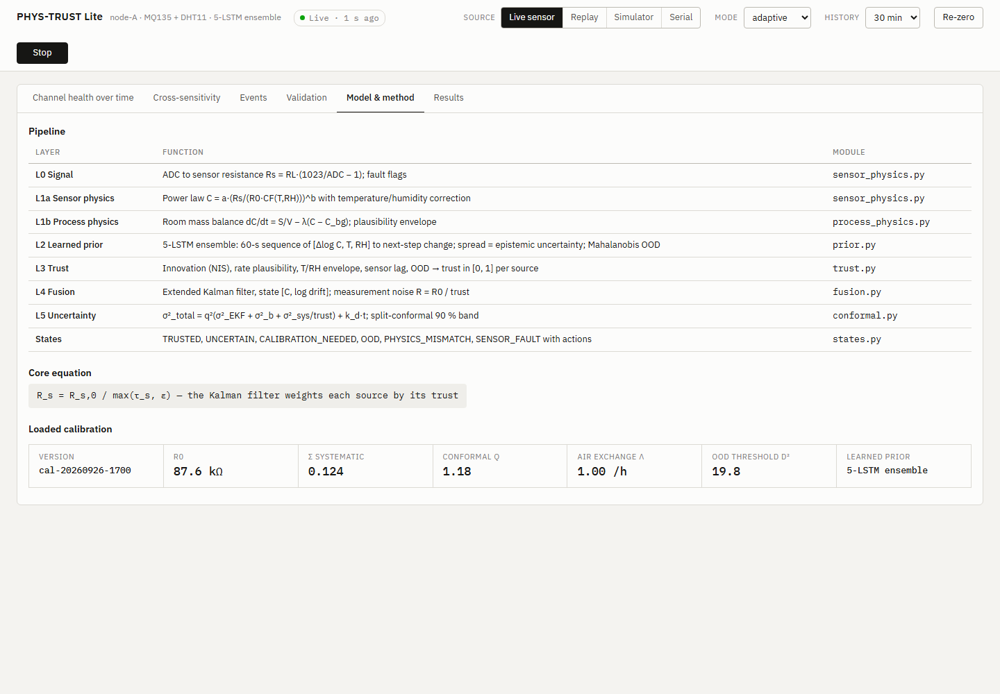 | 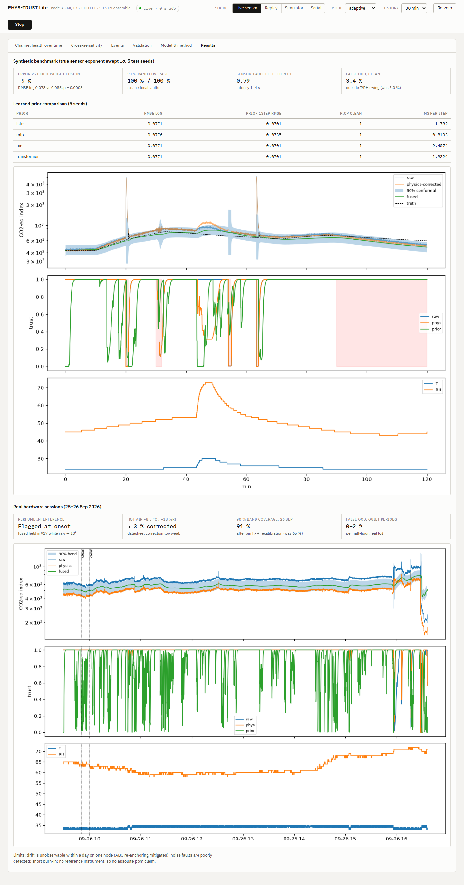 |

<p align="center">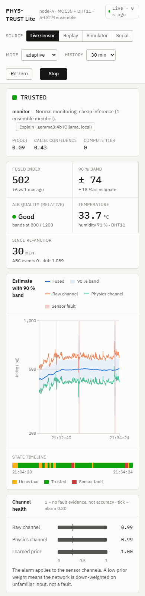<br><em>Mobile layout</em></p>

---

## How it works

<p align="center">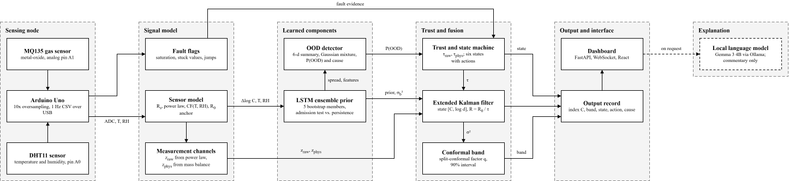<br><em>System architecture: sensing node, signal model, learned components, trust and fusion, output and interface.</em></p>

Full derivation: [docs/MATH_MODEL.md](docs/MATH_MODEL.md). Report: [docs/PHYS-TRUST_Lite_Report.pdf](docs/PHYS-TRUST_Lite_Report.pdf).

---

## Results

### Accuracy (validated)

| Measure | Value | Against |
|---|---|---|
| 90 % band coverage, UCI | **0.91** (target 0.90) | certified CO analyser, 10-month test |
| R², trust-adaptive fusion, UCI | **0.62** | certified CO analyser, 10-month test |
| Error vs fixed-weight fusion | **−9 %** (RMSE log 0.0776 vs 0.0854, paired p = 0.0008) | synthetic ground truth, 5 seeds |
| Learned-prior one-step skill | **0.616** (LSTM; MLP rejected at −12.9) | persistence, held-out data (report Table 5a) |
| 90 % band coverage, real node, undisturbed | **0.70** with the LSTM prior (target 0.90) | reference-free consensus curve; provisional (≈ 5.5 h burn-in) |
| Absolute ppm | not claimed | no reference instrument on this node |

**UCI comparison (10-month test, scored against the certified CO analyser).** Trust-adaptive fusion beats
fixed weights but not the best single channel, so its benefit here is calibrated uncertainty and fault
handling, not lower point error.

| Method | RMSE (log) | R² | 90 % coverage |
|---|---|---|---|
| Static formula, no T/RH (existing practice) | 0.448 | 0.65 | n/a |
| Raw channel through the filter | 0.475 | 0.69 | 0.92 |
| Fixed-weight fusion | 0.506 | 0.60 | 0.89 |
| Trust-adaptive fusion | 0.493 | 0.62 | 0.91 |

The learned prior was disabled on the UCI data: it passed the one-step test (skill 0.04) but failed the
fused-level test. Sequence priors (LSTM, TCN, Transformer) improve one-step error by about 60 % over
persistence but tie at the fusion level (fused log RMSE 0.0771 for all three).

The UCI reference measures carbon monoxide, not CO₂, so it shows that the index tracks co-varying urban
pollution; it does not validate CO₂-equivalent accuracy.

Channel health and trust scores are **fault evidence, not accuracy**: 1.0 means "no evidence against this channel".

### Fault detection (synthetic injection, 3 seeds)

| True condition | Time in SENSOR_FAULT |
|---|---|
| Swab / perfume-like spike | 98 % |
| Stuck sensor | 93 % |
| ×3 noise | 41 % (alarm metric detected it in 1 of 5 seeds) |
| Slow drift | not detectable within a day (see limits) |

Sensor-fault alarm over 5 seeds: precision 0.86 ± 0.12, recall 0.73 ± 0.03, F1 0.785 ± 0.052; latency about
1 s for spikes and 4 s for stuck values; all 20 of 20 sensor faults attributed to the sensor. On the real UCI
data with injected faults, detection is weak (F1 0.14). Noise-type faults are poorly detected.

### Real hardware

- **Perfume at 5–10 cm for 60 s:** flagged at onset, both sensor channels distrusted and attributed to the
  sensor; the raw index rose to about 2.4 × 10⁶ while the fused estimate held near 871 and its band widened.
- **Hot air (+8.5 °C / −18 %RH):** the datasheet T/RH correction removed only about 3 % of the shift; the fused
  estimate moved by −0.024 because trust dropped (confounded by residual perfume).
- **Wiring faults:** a floating analog pin (burst noise ≈ 107 counts) and loose contacts (instant 15–30 % steps)
  were detected as sensor faults and fixed.

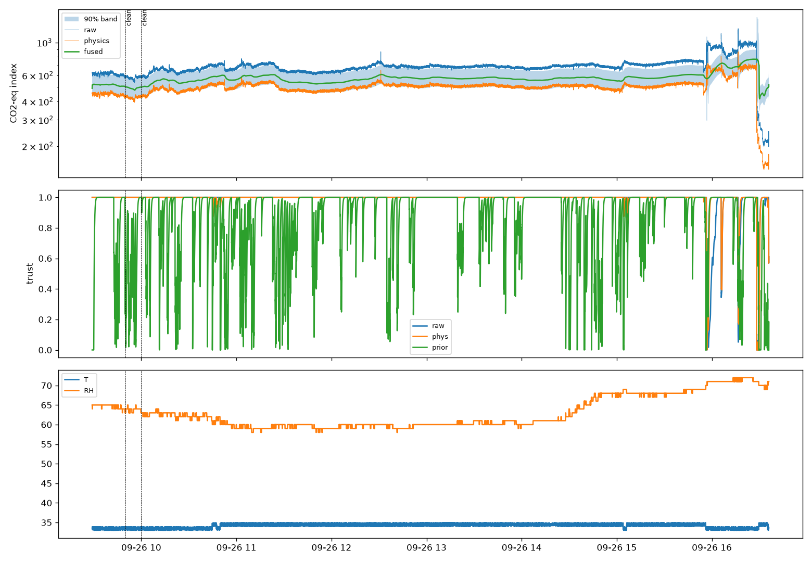

### Validation against reference data

| UCI Air Quality (certified analyser) | DHT11 vs Open-Meteo (Chennai) |
|---|---|
| 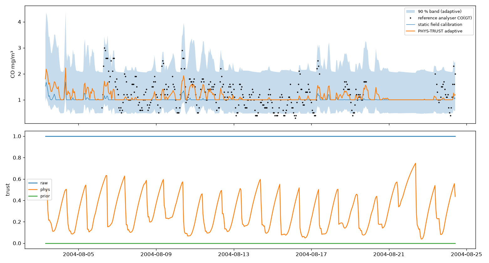 | 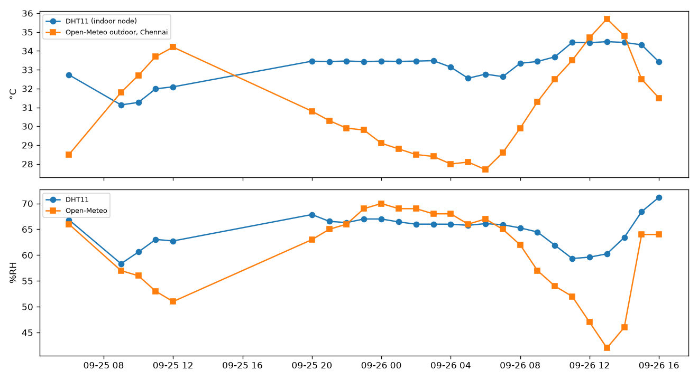 |

DHT11 vs outdoor weather over 26 h: temperature bias +2.3 °C (indoor node), humidity correlation r = 0.76.

### Out-of-distribution flagging

| Data | Before redesign | After |
|---|---|---|
| Synthetic clean, outside the T/RH swing | 5.0 % | 3.4 % |
| Synthetic clean, all | 15 % | 10 % |
| Real node, quiet half-hours | n/a | 0–2 % |

On the real log the remaining out-of-distribution time falls on genuine events: warm-up after power-on (78 %
of the first half-hour), the perfume and hot-air tests (26 %), and warm-up after a 7.5-hour power outage
(51–96 %). Genuinely unusual inputs (85 % RH, 40 °C, cold-dry air, perfume-like spikes) are still flagged.

---

## Hardware

| Part | Pin | Notes |
|---|---|---|
| Arduino Uno (CH340) | USB, COM8 | 115200 baud, 1 Hz CSV |
| MQ135 gas sensor | **A1** | 10× oversampled with a discard read before each channel (ADC mux settling) |
| DHT11 | **A0** (used as digital) | keep ≥ 10 cm from the MQ heater, upwind |
| A2 | unconnected | logged as `mq7_adc`; ignore |

- Measure the MQ135 load resistor (AO–GND, module unpowered). The stock value is often 1 kΩ; 10–22 kΩ gives better
  resolution. Recalibrate after any change.
- Warm the heater at least 2 h before calibrating (24–48 h for a new sensor).
- Firm, fixed wiring matters: a loose jumper shows up as instant level steps.

Firmware: [firmware/phys_trust_node/phys_trust_node.ino](firmware/phys_trust_node/phys_trust_node.ino)
(needs the Adafruit *DHT sensor library*).

---

## Installation and running

### Requirements
- Python 3.12, Node.js 18+ (only to rebuild the frontend)
- Arduino CLI or IDE (only to flash the firmware)
- Optional: [Ollama](https://ollama.com) with `gemma3:4b` for explanations

```bash
pip install -r requirements.txt
cd web && npm install && npm run build && cd ..
```

### 1. Log the sensor
```bash
python tools/logger.py --port COM8 --out data/burnin.csv
```
The logger reconnects after unplugging and reopens the port if the board goes silent for 30 s.

### 2. Calibrate
Record 10 minutes of clean air (window open, nobody in the room), then:
```bash
python tools/session_report.py --clean 09:50 10:00 --date 2026-09-26 --history-h 0.35 --train-until 15:50 --external
```
This writes `models/bundle.joblib`: R0, systematic error, conformal factor and the LSTM prior (trained with the
DALTON external data when `--external` is given).

### 3. Dashboard
```bash
python -m uvicorn server.app:app --port 8600
```
Open **http://localhost:8600**, or double-click `start_dashboard.bat`.

| Source | Use |
|---|---|
| Live sensor | follows `data/burnin.csv` while the logger runs |
| Replay | replays a recorded log |
| Simulator | synthetic day with injected faults, no hardware needed |
| Serial | reads the Arduino directly (stop the logger first) |

Deep links: `#src=sim&tab=valid`. Development server with hot reload: `cd web && npm run dev` (port 5173).

### 4. Explanations (optional)
```bash
ollama pull gemma3:4b
ollama serve
```
Press **Explain · gemma3:4b** on the dashboard.

### Other tools
```bash
python -m phystrust.evaluate          # synthetic benchmark and ablation table
python tools/validate_uci.py          # UCI Air Quality validation
python tools/validate_weather.py      # DHT11 vs Open-Meteo
python tools/compare_priors.py        # MLP / LSTM / TCN / Transformer priors
python tools/overnight_watch.py --hours 7 --calibrate   # unattended health watch + gated calibration
python tools/screenshots.py           # regenerate README screenshots
```

---

## Project layout

```
firmware/phys_trust_node/   Arduino sketch
phystrust/
  sensor_physics.py         Rs, power law, T/RH correction
  process_physics.py        mass balance, decay fit, plausibility envelope
  prior.py                  MLP / LSTM / TCN / Transformer deep ensembles, OOD (Gaussian / mixture)
  external.py               DALTON external training data
  trust.py                  per-channel trust
  fusion.py                 EKF with trust-scaled noise
  conformal.py              split-conformal band
  states.py                 trust state machine, P(OOD), actions
  pipeline.py               per-sample chain, re-zero, ABC, provenance
  calibrate.py              bundle building and admission test
  reference.py              Open-Meteo weather
  simulate.py, faults.py    synthetic room and fault injection
  evaluate.py               ablation and benchmark
  llm_explain.py            Gemma 3 4B explanations via Ollama
server/app.py               FastAPI + WebSocket backend
web/                        React (Vite) dashboard
tools/                      logger, calibration report, validation, screenshots
docs/                       math model, report, screenshots
```

---

## Data sources

| Dataset | Use | Licence |
|---|---|---|
| **DALTON** — Karmakar et al., *Indoor Air Quality Dataset with Activities of Daily Living in Low to Middle-income Communities*, 2024 ([arXiv:2407.14501](https://arxiv.org/abs/2407.14501), [GitHub](https://github.com/prasenjit52282/dalton-dataset)) | LSTM prior training: 1 Hz CO₂/T/RH, West Bengal, June + October | AGPL, non-commercial research |
| **UCI Air Quality** (De Vito et al.) | reference validation against a certified analyser | CC BY 4.0 |
| **Open-Meteo** | live and historical Chennai weather | CC BY 4.0 |
| **NOAA Mauna Loa** | clean-air CO₂ background (426 ppm) | public domain |

---

## Known limits

- One node: no spatial information; the mass balance assumes a well-mixed room.
- Slow sensor drift cannot be separated from a real slow change on one node within a day; re-zero and automatic
  baseline calibration (ABC) mitigate it.
- Raw and physics channels share one sensor, so their errors are correlated.
- The datasheet temperature/humidity correction is weak on this sensor.
- Noise faults are detected less reliably than spikes and stuck readings.
- No reference instrument on the node: accuracy is stated against a consensus curve and against UCI reference data,
  not as absolute ppm. The MQ135 is not gas-selective.
- On the UCI reference data, trust-adaptive fusion beats fixed weights but not the best single channel (R² 0.62
  vs 0.69 raw); fault detection on those real data is weak (F1 0.14).
- The learned prior improves one-step prediction but not fused accuracy, and is disabled automatically when
  training data are scarce (as on UCI).
- Real-node results are provisional: short burn-in (≈ 5.5 h), unmeasured load resistor, no verified outdoor
  reference; DHT11 read failures reached 26 % in one hour. Drift tracking and ABC over several days are untested.

---

## Contributors

<table>
  <tr>
    <td align="center"><a href="https://github.com/jeyadev-jd"><br><b>Jeyadev</b></a><br><sub>@jeyadev-jd</sub></td>
    <td align="center"><a href="https://github.com/theflighttechofficial"><br><b>Varun Vaibhav.S</b></a><br><sub>@theflighttechofficial</sub></td>
    <td align="center"><a href="https://github.com/Naveenvaidani"><br><b>Naveen Vaidani</b></a><br><sub>@Naveenvaidani</sub></td>
  </tr>
</table>

---

## Author

**Jeyadev R** · AI/ML Engineer & Full-Stack Developer · Chennai, India

- Portfolio: [jeyadev.dev](https://jeyadev.dev/projects/phys-trust-lite)
- GitHub: [@jeyadev-jd](https://github.com/jeyadev-jd)
- LinkedIn: [r-jeyadev](https://www.linkedin.com/in/r-jeyadev)

If this project is useful to you, a ⭐ on the repo helps others find it.
